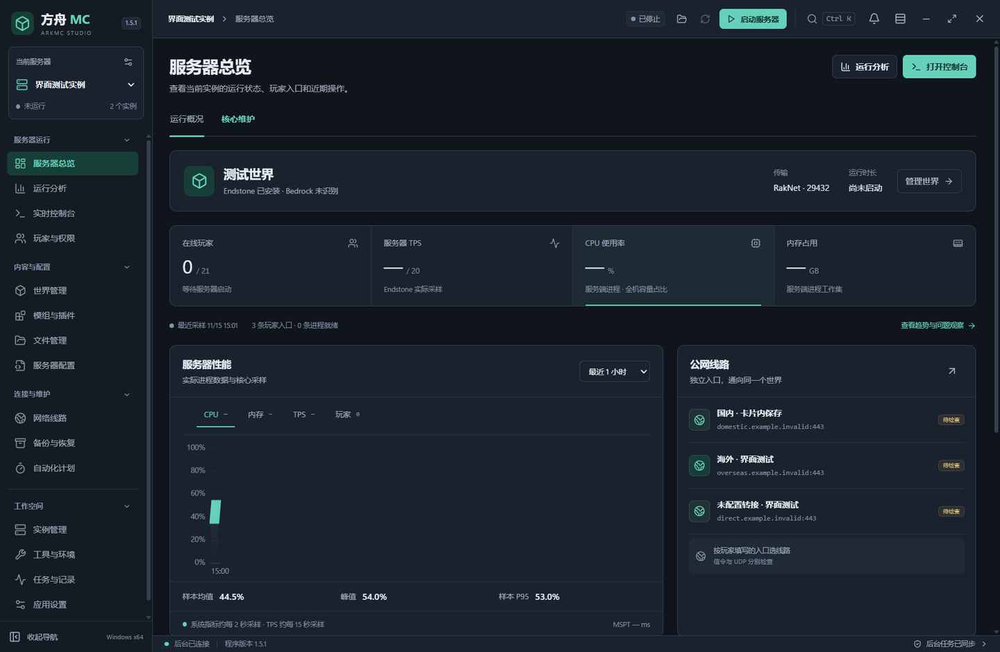
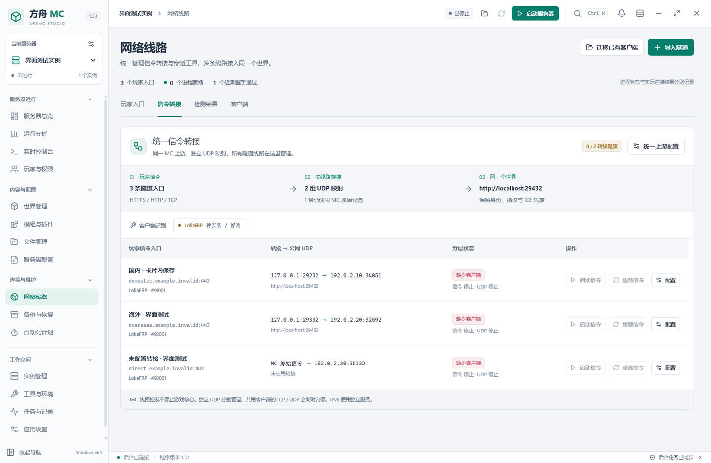

# ArkMC Studio

ArkMC Studio 是面向 Windows x64 的 Minecraft 基岩版专用服务器桌面管理程序。它可关联已有 BDS 或 Endstone 实例，也可创建新实例；服务器世界和核心目录仍由用户选择并管理。

当前程序版本：**1.5.1**。界面、管理服务和便携程序使用同一发行版本号；发现旧服务时先确认更新，不以旧服务兼容模式进入新版工作台。项目处于持续维护阶段，当前支持 Windows x64，未承诺 Linux、macOS 或 ARM64。

## 功能

- 多实例管理、启动状态、控制台、玩家记录、权限与允许名单。
- 只读运行分析：性能趋势、聚合样本均值／峰值／P95、日志问题归类、任务与备份观察，以及 JSON 摘要／CSV 数据导出。
- 世界、行为包、资源包、Endstone 插件、服务器配置和受限文件管理。
- 在线世界备份、完整实例快照、校验和恢复前保护快照。
- Lolia、SakuraFrp 与云 FRP 客户端统一识别，集中信令转接、线路诊断和质量采样。
- 可选原生 IPv6 玩家入口、Cloudflare DDNS 配合与 HTTPS 证书自动续期。
- 总览汇总隧道与原生 IPv6 入口；网络页支持搜索、状态筛选、紧凑总览和玩家地址清单导出。
- 深色／浅色主题、舒适／紧凑密度、按需加载页面与图表、未保存草稿保护和页面错误恢复。
- 官方 BDS 与 Endstone 安装和更新、计划任务、操作记录。
- 独立后台、SQLite 持久化、本机命名管道鉴权及受限 Electron IPC。
- 启动检查历史数据和客户端登记，整理未使用的桌面运行资源，生成整理报告。
- 托盘“退出程序”依次正常停服、停止托管线路、关闭后台和界面。

程序不会把网络探测结果冒充成真实玩家登录，也不会为官方 BDS 推算其未提供的 TPS。备份、恢复、更新和进程控制均以实际文件、配置、日志和进程状态为准。

## 获取与运行

推荐从 [GitHub Releases](https://github.com/xiangan666/ark-mc-studio/releases) 下载当前稳定版 `ArkMC-Studio-1.5.1-Windows-x64.exe`，按同页 `SHA256SUMS` 核对后直接运行，无需预装 Node.js、Go 或 uv。首次打开后可新建实例或显式关联已有 BDS / Endstone 目录；进入服务器总览、实例资料可读取，即表示工作台已连接管理服务。实际开服仍需要下载或准备相应核心并接受其条款。

PowerShell 校验示例（在下载目录执行，将输出与同页摘要文件对比）：

```powershell
Get-FileHash -LiteralPath .\ArkMC-Studio-1.5.1-Windows-x64.exe -Algorithm SHA256
```

EXE 当前未签名，SHA-256 只证明文件下载一致性。更新时先通过托盘正常退出旧版，保留用户数据、工具和服务器目录，再替换便携程序，详见 [配置与迁移](docs/configuration.md)。源码使用者也可以自行构建：

```powershell
npm ci
npm run package
```

打包程序输出到 `release/`。便携程序首次运行会在用户数据目录保存数据库和备份，并在程序目录的 `managed-tools/` 保存客户端、运行环境及实例相关数据。迁移程序时要一并保留这些数据目录，并检查实例路径。不要把 `managed-tools/` 或真实服务器目录提交到 GitHub。

`release/` 包含便携 EXE、版本化的 SHA-256 文件及记录源码提交的发行清单。解包目录、构建配置及压缩中间文件输出到 `_work/package/`；必要说明及许可证内置于程序。源码构建需要真实 Git 提交，具体依赖与自动发版见 [发布指南](docs/releasing.md)。

本地项目可运行 `启动方舟MC.cmd`，它指向本次发行的便携程序。窗口关闭默认缩到托盘；托盘“退出程序（同时关闭后台）”会完整退出。有服务器运行时先询问是否正常关服，等待保存完成，不强行终止游戏进程。

## 工作台布局

1.5.0 重新整理全部十五个页面。侧栏固定显示当前服务器与实例选择，标题栏显示当前页面、运行状态和服务器启停；工作空间页面不显示当前实例的启停按钮。可收起侧栏、折叠功能组，用 Ctrl+K 搜索功能、实例与常用操作。

| 侧栏分组   | 页面                                         |
| ---------- | -------------------------------------------- |
| 服务器运行 | 服务器总览、运行分析、实时控制台、玩家与权限 |
| 内容与配置 | 世界管理、模组与插件、文件管理、服务器配置   |
| 连接与维护 | 网络线路、备份与恢复、自动化计划             |
| 工作空间   | 实例管理、工具与环境、任务与记录、应用设置   |

总览默认显示“运行概况”，核心版本检查与更新策略在“核心维护”。运行分析按性能趋势、观察与建议、日志归类、运维与入口切换。应用设置使用水平分类；文件管理保留可拖动或用方向键调整的目录分栏。

网络页按任务分为四个区域：

- **玩家入口**：复制或导出地址、搜索和筛选、卡片／紧凑总览、线路启停与转接配置。
- **信令转接**：统一 MC 上游、检查独立 UDP 配对与客户端识别、启停及重载信令。
- **检测结果**：已有质量报告、单线／全线采样、基础诊断与握手重连检测；打开页面不会自动执行检测。
- **客户端**：独立 UDP、全部客户端进程、目标调整、日志与进程操作。

版本数据整理在“工具与环境 → 版本整理”，不再占据网络首屏。命令面板、总览入口和带目标的跳转会自动打开对应分区并恢复焦点。分类标签支持左右方向键、Home 和 End；深色／浅色、舒适／紧凑两套偏好继续保留。

完整的页面功能覆盖、设计原则与验收要求见 [界面设计规范](.github/INTERFACE.md)。





## 网络线路与统一信令

在“网络线路 → 信令转接”中查看全部玩家信令入口、转接监听、独立公网 UDP 映射和客户端识别结果。HTTP/TLS 信令可用、转接健康、UDP 客户端运行和真实传输握手分别显示；它们不代表玩家已经成功登录。

| 线路服务商           | 工具登记                  | 配置格式 |
| -------------------- | ------------------------- | -------- |
| Lolia                | `bin/lolia/current.json`  | TOML     |
| SakuraFrp            | `bin/sakura/current.json` | INI      |
| 云 FRP (`frp-panel`) | `bin/frp/current.json`    | TOML     |

客户端按服务商识别，不借用另一厂商同名的 `frpc.exe`。缺少或失效时通过“工具与环境”安装修复。云 FRP 的 TCP 信令与 UDP 可以包含于同一配置，客户端只启动和停止一次；改写信令本机目标时保留认证、公网端口与 UDP 目标。

“统一上游配置”可以对所选、已停止的信令统一 MC 回环上游及原始 UDP 候选来源，保留各线路监听端口和公网 UDP 映射。运行中的信令锁定；保存前再次检查状态及原配置，冲突时停止并提示。多个可能的 UDP 隧道必须在转接配置中明确配对，不自动猜测。修改后手动启动信令。

信令转接只改写明确匹配的核心 UDP 候选，保留服务器身份、DTLS 指纹和 ICE 凭据；不匹配时明确失败，避免串用线路。高级诊断执行 ICE / DTLS / SCTP 与重连检查，真实账号进入世界仍需由玩家客户端验证。

## 更新与数据整理

打开新版发现旧服务会显示“保留运行中的服务器和线路，更新程序？”。确认后只更换管理服务，核对新服务版本、原游戏 PID 和控制能力，不执行游戏、穿透、信令或 IPv6 的停止／启动／重启。任务正在执行或状态不明时拒绝更新，取消则退出新版并保留旧服务。

从 1.4.0 起，新启动的托管游戏由独立 Node 会话宿主持有标准输入输出并持续写入日志。会话状态和鉴权文件位于用户数据目录 `server-hosts/<实例ID>/`，管理服务通过本机鉴权命名管道重新连接；重启管理服务不会关闭游戏控制台。宿主与实际游戏进程的父子关系、启动时间和实例路径都需核验。宿主随游戏正常退出；托盘完整退出仍会先发送正常停服命令，再关闭宿主、托管线路和管理服务。

**首次从旧架构迁移的边界：**1.3.x 及更早版本直接在管理服务内持有游戏控制台管道，不能无损转交已打开的管道。若仍有此类活动会话，新版明确拒绝自动替换服务，不杀进程、不假装已完成更新。首次切换由用户手动完成；之后由 1.4.0 及更新版本启动的实例即可在管理服务更新时持续运行和控制。旧版线路可继续运行，无需为切换管理服务而停止。

同版启动及完成更新后自动检查工具登记和旧运行资源。“工具与环境 → 版本整理”可重新执行并查看报告：

- 统一旧 `frp-panel` 客户端登记为官方 FRP 登记，保留原文件以便检查。
- 仅清理 `desktop-host/<版本>-<摘要>` 下确认完整、无进程引用的旧资源；保留当前版、所有使用中的资源和一份闲置回退资源。有任务时延后清理。
- 世界、核心、数据库、备份、凭证、未知目录和含链接的资源不会自动删除。`server-links/<实例ID>` 允许链接到独立外部核心，仍禁止真实核心与工具目录互相嵌套。
- 报告保存到 `managed-tools/maintenance/upgrades/<版本>-<时间>.json`，`latest.json` 保存最近结果。用户数据目录的 `program-transition.json` 记录中断的更新，再次确认时重新核对实例及任务。

用户数据默认在 `%APPDATA%/ArkMC Studio/`。`ARK_MC_DATA`、`ARK_MC_TOOLS` 可分别指定数据和工具目录。整理不会重置用户配置或删除不明文件。

## 原生 IPv6 入口

IPv6 使用独立 HTTPS / UDP 服务，与隧道并存。玩家和服务器均需公网 IPv6；Cloudflare AAAA 使用 DNS only，路由器与 Windows 防火墙只放行所选 TCP 信令和 UDP 端口。DDNS 应指向服务器网卡固定地址。前缀变化会重新绑定并要求玩家重连。

配置在 `managed-tools/direct/<实例ID>/route.json`，初次部署需准备网卡、DDNS、证书和核心端点。`localIPv4/localUdpPort` 必须与核心 SDP 端点一致。Cloudflare 令牌使用当前 Windows 用户 DPAPI 保存，证书及 ACME 账户保存在该实例的 `acme/`；迁移 Windows 用户需重新保护令牌。lego DNS-01 续期成功后热加载证书，失败保留现有证书。发布入口前使用外网 IPv6 客户端实测。

## 开发

需要 Windows x64、Git、Node.js 24.10+ 的 24 系列或 26 系列，以及 npm 11。发行构建使用 [.node-version](.node-version) 固定的 Node.js；`packageManager` 记录维护使用的 npm 版本。`npm run prepare:resources` 还需要 uv 0.12.20 及 Go `tools/nethernet-route-check/go.mod` 指定版本，准备时从源码重建诊断探针，并收集实际依赖及运行时版本的许可证。

```powershell
npm ci
npm run prepare:resources
$env:ARK_MC_DATA = Join-Path $env:TEMP 'arkmc-dev-data'
$env:ARK_MC_TOOLS = Join-Path $env:TEMP 'arkmc-dev-tools'
$env:ARK_MC_NO_DISCOVER = '1'
npm run dev
```

常用验证和构建命令：

```powershell
npm run check
npm audit --omit=dev --audit-level=moderate
npm run test:python
npm run test:go
npm run build
npm run test:ui
npm run test:program-ui
npm run test:session
npm run package
npm run test:portable
npm run release:verify
```

`npm run test:ui` 使用 Playwright 驱动 Electron，适合在 Windows 桌面环境运行。包括十五页交互、深浅主题／密度／窗口布局矩阵、分区键盘操作、文件分栏和隐藏区域快捷跳转；脱敏界面截图及检查结果输出至 `test-results/workspace-1.5/`。`npx tsx scripts/acceptance.ts` 会联网下载官方服务器核心、创建隔离临时实例并占用测试端口；它不应指向正式服务器。

完整布局矩阵通过后，可用 `npm run test:ui -- --skip-layout-matrix` 针对性重跑页面交互、线路与数据保护；该模式会明确记录跳过布局矩阵。界面回归期间不要重建 `out/`，以免正在运行的页面失去懒加载资源。

架构分工、进程生命周期和信任边界见 [架构说明](docs/architecture.md)。`test:session` 使用隔离的标准输入输出可执行样本验证实际更换管理进程后控制台仍可用，不启动正式 Minecraft 世界。`npm run check` 检查格式、清单与文档一致性、公开源码边界、脚本语法、类型和单元测试。

## GitHub 项目文档

本 README 提供用户操作入口，维护参考按职责链接，避免重复维护同一事实。

- [界面设计规范](.github/INTERFACE.md)
- [架构与边界](docs/architecture.md)
- [配置与数据迁移](docs/configuration.md)
- [版本与 Release 流程](docs/releasing.md)
- [常见故障排查](docs/troubleshooting.md)
- [第三方组件说明](THIRD_PARTY_NOTICES.md)
- [贡献指南](CONTRIBUTING.md)
- [安全问题报告](SECURITY.md)
- [行为规范](CODE_OF_CONDUCT.md)
- [更新日志](CHANGELOG.md)

## 隐私与安全

实例目录、管理数据库、备份、隧道凭证、日志、截图和运行时下载均可能包含个人或服务器信息。提交 Issue、Pull Request 或诊断资料前，请先删除凭证、IP、域名、玩家名称、文件路径和世界数据。漏洞报告请按 [安全策略](SECURITY.md) 私下提交，不要公开发布可利用细节。

## 许可

ArkMC Studio 源码采用 MIT License。Minecraft、BDS、Endstone、隧道客户端及打包依赖均由各自作者提供并遵循其许可或服务条款；详见 [第三方组件说明](THIRD_PARTY_NOTICES.md)。本项目与 Mojang 或 Microsoft 无隶属关系。

问题与功能建议通过 [Issues](https://github.com/xiangan666/ark-mc-studio/issues) 提交；维护者：相安，邮箱：`3199912548@qq.com`。保留原有 ArkMC Studio 作者与贡献者声明。
